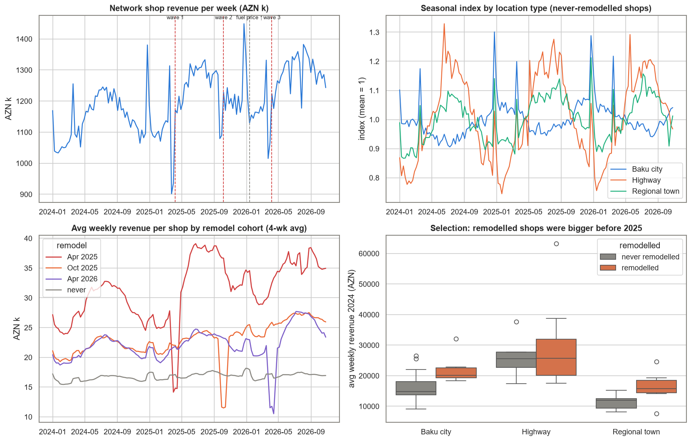
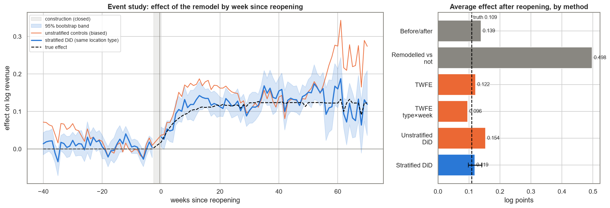
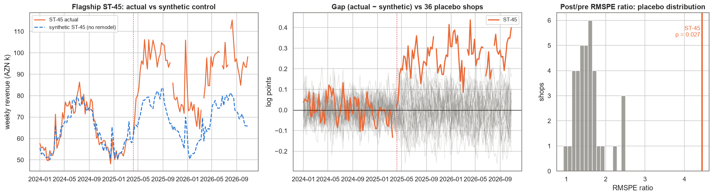
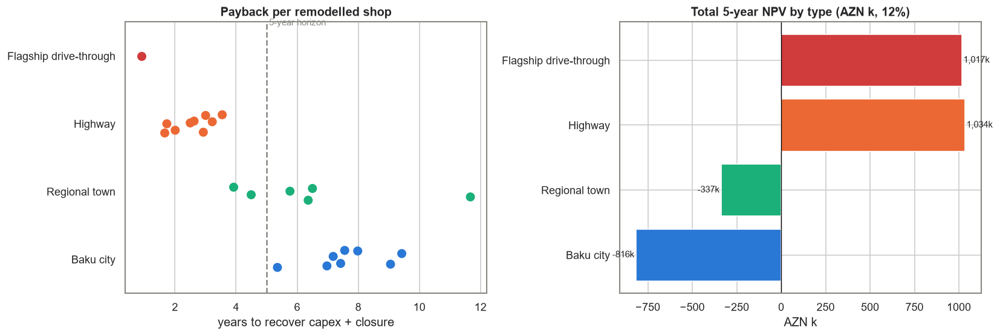

# Did the New Shop Format Work? — Causal Impact of a Staggered Store Remodel

**Daily Data Analytics Project · Day 17**

## Business question
A fuel-station network in Azerbaijan runs a convenience shop at each of its **60 stations**: Baku city, highways and regional towns. Since April 2025 it has remodelled **24 shops** to a new format (coffee bar, hot food, self-checkout) in three waves: April 2025, October 2025 and April 2026. A remodel costs AZN 150–230k and closes the shop for two weeks. Before approving wave 4, the board asks: **how much extra revenue did the remodel really cause, does it depend on location, and which stations should be next?**

Why a simple comparison fails:
- **Selection.** Management remodelled the biggest shops first. Before 2025 they already sold AZN 23.5k a week, against 16.4k for the other shops.
- **Confounders.** Revenue also moves with growth, the New Year and Novruz peaks, the January 2026 fuel-price rise, and a ±20% summer peak on highways that Baku city shops don't have.
- **Staggered timing with ramp-up.** Waves start on different dates and the effect builds over several weeks. Two-way fixed effects (TWFE) is known to be biased in this setting.

What the project does:
1. Cleans 2.8 years of weekly POS data. Station codes are normalised, duplicate uploads dropped, revenue sent in qəpik rescaled, and construction weeks matched to the remodel log.
2. Shows why the quick answers are wrong: before/after, remodelled vs not, and TWFE.
3. Estimates the effect with **stratified difference-in-differences** (Callaway–Sant'Anna style): only never-remodelled shops of the **same location type** are used as controls. Includes an **event study**, a pre-trend placebo test, a **cluster bootstrap**, and a split of the effect into transactions vs basket.
4. Measures the flagship **drive-through** station with a **synthetic control** and placebo-in-space permutation inference.
5. Computes ROI, payback and 5-year NPV per location type, and ranks wave-4 candidates.
6. Checks every estimate against the **true effect** that the synthetic-data generator used.

## Key results (from the executed notebook)
| KPI | Value |
|---|---|
| Network shop revenue, last 52 weeks | AZN 65.0 M (60 shops, avg basket AZN 12.18) |
| Remodel capex to date | AZN 4.64 M (24 shops) |
| **Average effect of the remodel** (stratified DiD) | **+12.6% revenue** (95% CI +10.3% … +15.2%), true effect +11.5% |
| Pre-period placebo (weeks −30…−3) | 0.009 log pts, 95% CI −0.004 … 0.023: no pre-trend |
| Extra revenue to date | ≈ AZN 5.5 M (true: 4.9 M) |
| Where the uplift comes from | 65% more transactions, 35% bigger basket |
| Steady-state uplift by location | **Highway +19%**, Regional town +9%, Baku city +7% |
| Flagship drive-through ST-45 (synthetic control) | **+31%**, permutation p = 0.027 (rank 1 of 37) |
| Median payback | Drive-through 0.9 y · Highway 2.6 y · Regional 6.1 y · Baku city 7.5 y |
| Shops with positive 5-yr NPV (12%) | Highway 9/9 · Regional 0/6 · Baku city 0/8 |

### Same data, different methods (average effect in log points; truth = 0.109)
| Method | Estimate | Problem |
|---|---|---|
| Before/after (26 w) on remodelled shops | 0.139 | picks up seasonality and growth |
| Remodelled vs never-remodelled | **0.498** | mostly measures how much bigger the chosen shops were |
| TWFE (station + week FE) | 0.122 | highway shops compared with mostly city controls, whose seasonality is opposite |
| TWFE (station + type × week FE) | 0.096 | biased down: already-remodelled shops act as controls during their ramp-up |
| DiD, all never-remodelled as controls | 0.154 | seasonal pre-trends |
| **Stratified DiD (same location type)** | **0.119** (CI 0.098–0.141) | covers the truth ✔ |

## Charts
### Network revenue, seasonality by location type, cohorts and selection on size


### Event study and method comparison


### Synthetic control: flagship drive-through ST-45 vs 36 placebo shops


### Payback and 5-year NPV by location type


## Findings & recommendations
| Area | Evidence | Recommendation |
|---|---|---|
| Overall effect | +12.6% revenue (CI 10.3–15.2%), ≈ AZN 5.5 M extra to date | Report this to the board instead of the dashboard's "remodelled vs not" gap, which is about 4× too high |
| Method | Naive gaps and TWFE miss; stratified DiD lands on the truth | Evaluate store initiatives with never-treated controls of the same location type, plus an event study |
| Ramp-up | The effect builds over 10–15 weeks, then levels off | Don't judge a remodel before week 16; hold a 20-week review |
| Location | Highway +19%, Regional +9%, Baku city +7% | **Wave 4 = ST-41, ST-31, ST-36, ST-34**, the only 4 old-format shops with a positive 5-year NPV (all highway) |
| Payback | Highway 2.6 y; Regional 6.1 y; city 7.5 y; NPV < 0 for every city and regional shop | Stop the full remodel off-highway; test a cheaper "coffee corner" format (capex under AZN 60k) |
| Drive-through | ST-45 +31% (p = 0.027), payback 0.9 y, NPV ≈ AZN 1.0 M | Pilot drive-through lanes at 2–3 more high-traffic highway stations |
| Measurement | The 5 old-format highway shops are the only clean highway controls | Keep ST-33 on the old format as a permanent holdout |
| Mechanism | ⅔ of the uplift from more transactions | Track footfall and coffee/food attach rate as leading KPIs |

## Tech stack
Python · pandas · NumPy · SciPy (SLSQP) · matplotlib · seaborn · Jupyter. Written from scratch in `causal.py`: cluster-robust (CR1) OLS for TWFE, stratified group-time DiD with never-treated controls, event-study aggregation, stratified cluster bootstrap, demeaned synthetic control and placebo permutation inference.

## Project structure
```
day-17-causal-impact-store-remodel/
├── data/
│   ├── generate_data.py           # synthetic data generator (fixed seed)
│   ├── weekly_sales.csv           # station × week revenue & transactions (with dirt)
│   ├── stations.csv               # station master + remodel log (date, capex, format)
│   └── ground_truth.csv           # true remodel effect per station-week (validation only)
├── images/                        # charts used in this README
├── causal.py                      # cleaning + estimators (TWFE, DiD, bootstrap, synthetic control)
├── build_notebook.py              # builds the notebook
├── store_remodel_causal_impact.ipynb  # executed analysis
└── requirements.txt
```

## How to run
```bash
pip install -r requirements.txt
python data/generate_data.py
python build_notebook.py
python -m nbconvert --to notebook --execute --inplace store_remodel_causal_impact.ipynb
```

## Notes & assumptions
- **The data is synthetic**, produced by `data/generate_data.py` with a fixed seed. The company and stations are fictional.
- Effects are estimated on log revenue (0.10 ≈ +10.5%). Each remodel cohort's baseline is the average of weeks −10…−3; the construction weeks (−2, −1) are excluded.
- ROI assumes a 35% gross margin on incremental sales (coffee and hot food), 28% on lost sales during closure, and a 12% discount rate over 5 years. Payback for future candidates uses the average effect of their location type.
- The estimated extra revenue (AZN 5.5 M) is about 12% above the truth (4.9 M). The point estimate is slightly high but inside its CI, so treat the AZN figure as a range.

## 🇦🇿 Azərbaycanca xülasə
Yanacaq doldurma şəbəkəsi 60 mağazadan 24-nü üç dalğada yeni formata keçirib: qəhvə barı, isti yemək və self-checkout. Sadə müqayisə ("yenilənən vs yenilənməyən") **+50% təsir** göstərir. Bu yanlışdır, çünki rəhbərlik əvvəlcə ən böyük mağazaları seçib. Eyni yerləşmə tipindəki (şəhər / magistral / rayon) heç yenilənməyən mağazaları nəzarət qrupu götürən **difference-in-differences** üsulu real təsiri **+12.6%** (95% CI 10–15%) göstərir. Bu, generatorun həqiqi +11.5% dəyərinə yaxındır. Təsir ilk 10–15 həftədə tədricən artır, sonra sabitləşir. Magistral mağazalarında artım **+19%**, Bakı şəhərində isə cəmi **+7%**-dir. Geri ödəmə müddəti: magistral 2.6 il, rayon 6.1 il, şəhər 7.5 il. **Sintetik nəzarət** metodu drive-through olan ST-45 stansiyasında **+31%** artım göstərir (p = 0.027) və bu stansiya xərcini 1 ilə çıxarır. Tövsiyələr: 4-cü dalğada yalnız 4 magistral stansiyası (ST-41, ST-31, ST-36, ST-34) yenilənsin. Şəhər və rayon mağazaları üçün daha ucuz "coffee corner" formatı sınaqdan keçirilsin. ST-33 isə gələcək ölçmələr üçün nəzarət mağazası kimi saxlanılsın.
